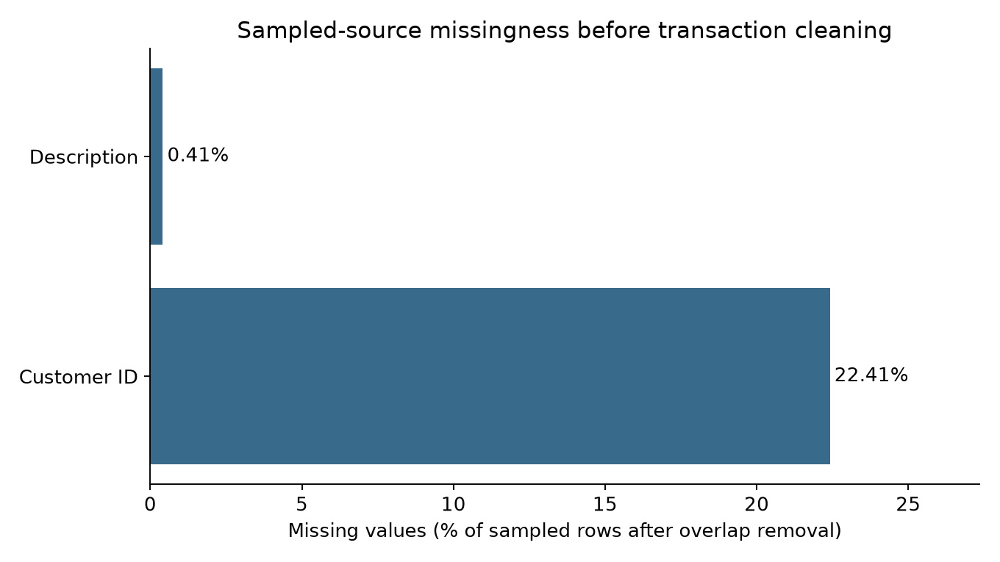
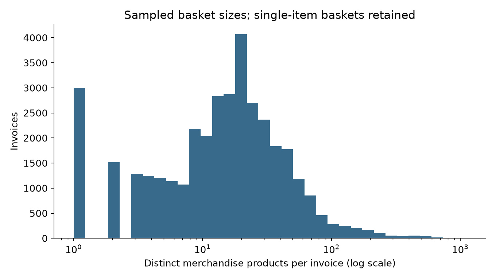
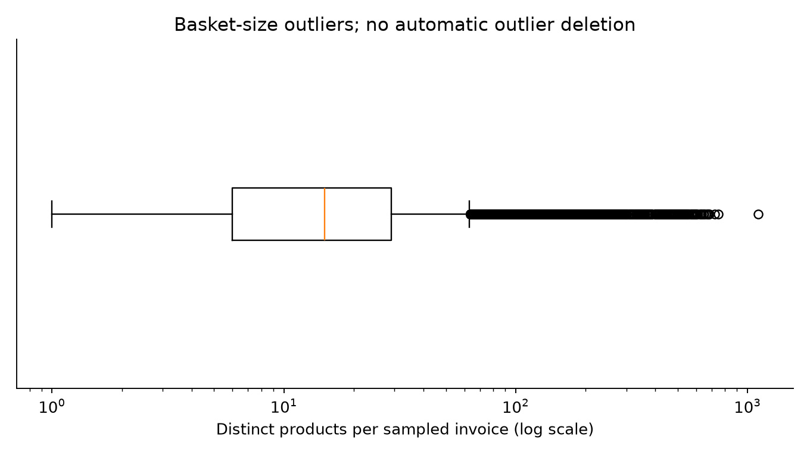
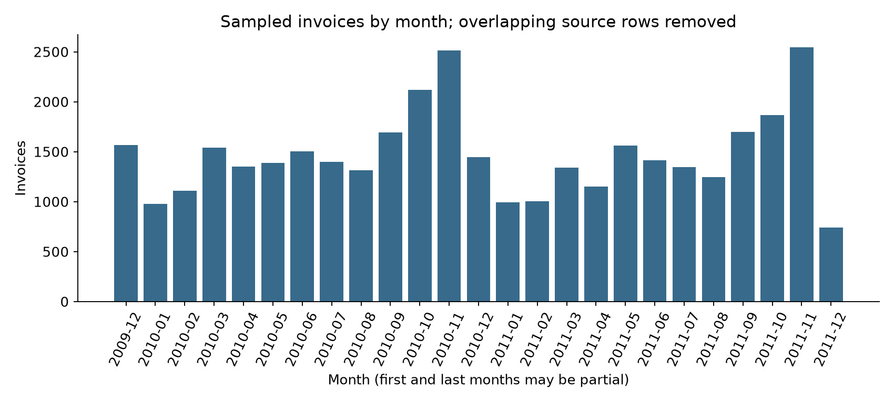
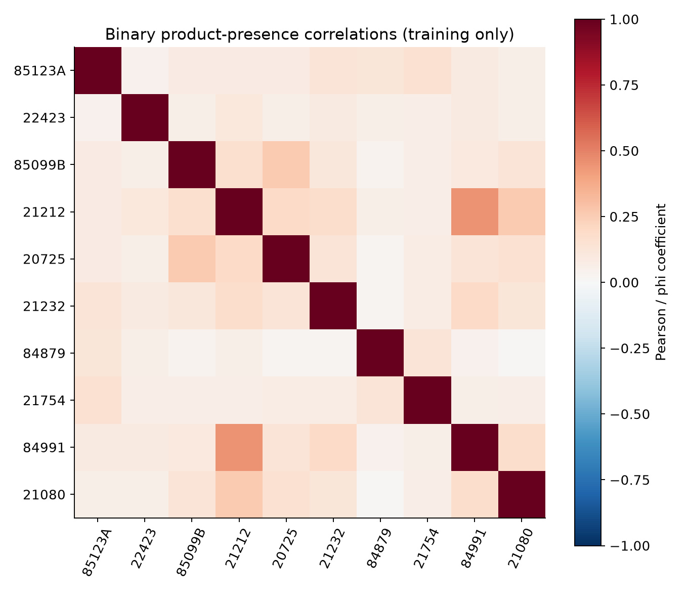
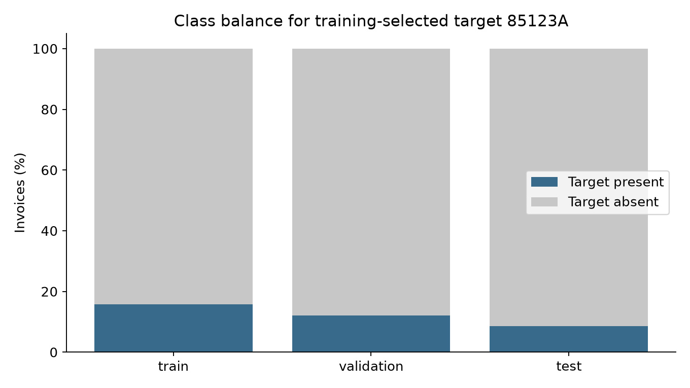
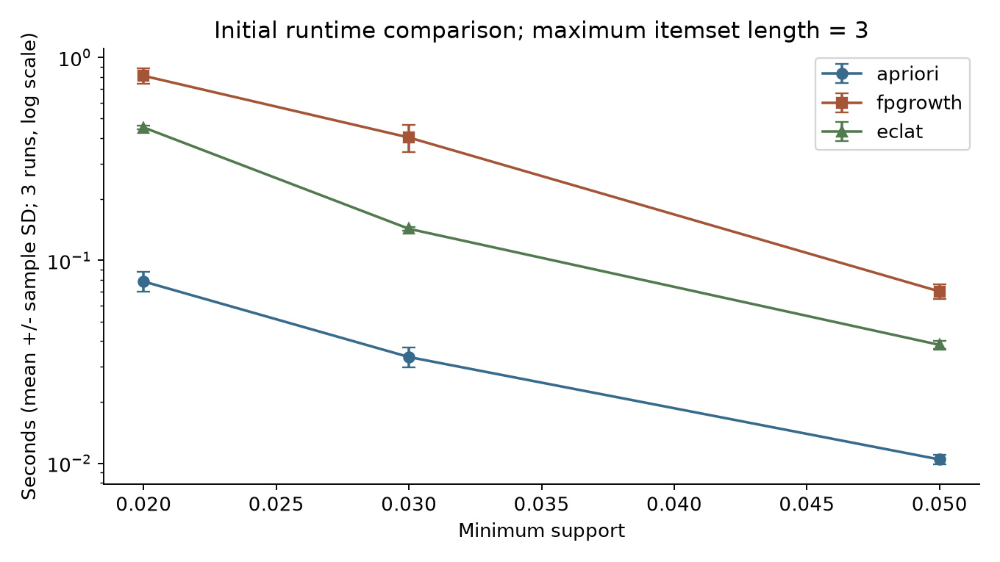

# Pazar Sepeti Analizi: Veri, Yöntem Planı ve İlk Bulgular

Gökhan Kartal

Öğrenci No: 2645007017 | SEED: 7017 | 16 Kasım 2026

[Kod deposu](https://github.com/gkhankartal/veri-madenciligi-pazar-sepeti)

## Özet

Bu çalışma, Online Retail II verisinde birlikte satın alınan ürünleri bulmak için Apriori, FP-Growth ve ECLAT yöntemlerini karşılaştırır. SEED=7017 ile 53.628 ham faturadan 50.000 fatura seçilmiş, temizleme sonunda 36.824 sepet elde edilmiştir. Zaman sıralı eğitim, doğrulama ve test ayrımı uygulanmıştır. Üç yöntem aynı destek sayılarıyla aynı sık ürün kümelerini üretmiştir. Başlangıç politikasında 61 ilişki kuralı bulunmuştur. Ek CART deneyinin test F1 değeri 0.353, çoğunluk baseline modelinin F1 değeri sıfırdır. Çalışma süresi bulguları uygulama, eşik ve küme uzunluğu kapsamıyla sınırlıdır. Bulgular çapraz satış adayları sağlar; nedensel satış artışı kanıtlamaz.

**Anahtar kelimeler:** pazar sepeti analizi, ilişki kuralları, Apriori, FP-Growth, ECLAT, Online Retail II.

## Problem, motivasyon ve çalışma kapsamı

### Araştırma soruları

Hangi ürünler aynı faturada beklenenden daha sık birlikte yer alır? Aynı sık ürün kümelerini üreten algoritmaların süreleri nasıl değişir? Eğitim döneminde bulunan kurallar sonraki dönemde korunur mu? Ön işleme ve eşik seçimi kural sayısını ne kadar etkiler?

### İş problemi

Birlikte satın alınan ürünler ürün sayfasında tamamlayıcı öneriler, paket kampanyası adayları ve ürün yerleşimi için kullanılabilir. Bu veride gerçek raf konumu, kampanya maruziyeti, stok bilgisi veya deneysel satış sonucu bulunmadığından raf düzeninin ya da gelir artışının gerçekleştiği ileri sürülmez.

### Gözlem birimi

Ana analizde bir fatura bir sepettir. Aynı ürün bir faturada birden fazla satırda bulunsa bile ürünün varlığı bir kez sayılır. Bir müşterinin farklı tarihlerdeki alışverişlerini bir araya getirmek ayrı bir davranış sorusudur. Müşteri geçmişi farklı zamanlardaki satın almaları birleştirirken, fatura bazlı analiz aynı alışverişteki birliktelikleri ölçer.

### Katkı ve sınır

Çalışmanın katkısı yeni bir madencilik algoritması önermek değildir. Aynı veride üç yöntemin sonucunu doğrulayan, zaman sırasını gözeten ve kural kararlılığını açıkça ölçen tekrarlanabilir bir deney düzenidir. Sonuçlar tüm perakende sektörüne veya bugünkü müşteri davranışına doğrudan genellenemez.

## Literatür özeti

### [1] Fast Algorithms for Mining Association Rules (1994)

Apriori ve AprioriTid, sık alt kümelerden aday ürün kümeleri üretir; AprioriHybrid iki yöntemin özelliklerini birleştirir. Yazarların deneylerinde yeni yöntemler önceki AIS ve SETM yaklaşımlarını aşmış; AprioriHybrid için ölçeklenme sonuçları sunulmuştur. Bu başarı sırası her veri ve uygulama için evrensel bir garanti değildir.

Bu çalışma: Bu proje AprioriHybrid geliştirmez; Python Apriori, FP-Growth ve ECLAT uygulamalarının aynı örneklemde sonuç eşitliğini ve sürelerini karşılaştırır.

### [2] Mining Frequent Patterns without Candidate Generation (2000)

FP-tree veriyi sıkıştırır; FP-Growth koşullu ağaçlarda örüntüyü büyüterek aday küme üretimini önler. Çalışma, kısa ve uzun sık örüntülerin aday üretmeden çıkarılabildiğini ve deneylerindeki verimlilik avantajını gösterir. Bu projede hız sırası veri özelliklerine ve Python uygulamalarına göre yeniden ölçülür.

Bu çalışma: Özgün çalışmanın algoritma tasarımı yerine, gerçek perakende sepetlerinde ortak eşik ve çıktı biçimiyle uygulama düzeyinde karşılaştırma yapılır.

### [3] Scalable Algorithms for Association Mining (2000)

Dikey işlem-kimliği listeleri ve kafes arama uzayının ayrıştırılması, sık ürün kümelerinin kesişimlerle aranmasını sağlar. Makale farklı veri yerleşimleri ve arama stratejilerini deneysel olarak karşılaştırır; yapısal özelliklerden yararlanmanın işlem maliyetini azaltabildiğini gösterir.

Bu çalışma: Projede şeffaf bir Python küme-kesişimi ECLAT uygulaması kullanılır. Bu uygulama özgün optimize kodla aynı performans iddiasında bulunmaz; doğruluk diğer algoritmalarla denetlenir.

### [4] arules - A Computational Environment for Mining Association Rules and Frequent Item Sets (2005)

R arules paketi işlem verisini temsil etme, sık kümeleri ve kuralları işleme altyapısı sunar; Apriori ve ECLAT uygulamalarına arayüz sağlar. Çalışmanın çıktısı, sık/kapalı/maksimal ürün kümeleri ve ilişki kuralları üzerinde çalışılabilen bütünleşik bir yazılım altyapısıdır; tahmin doğruluğunda üstünlük iddiası olarak kullanılmaz.

Bu çalışma: Bu projede R yerine Python kullanılır. Altyapı fikri, ortak veri temsili ve ortak kural metrikleriyle algoritmaların karşılaştırılmasına yol gösterir.

### [5] New Probabilistic Interest Measures for Association Rules (2007)

Bağımsızlık altında işlem verisi modeli kurulur; sentetik veri ve gerçek market verisiyle güven/lift incelenir, hyper-lift ve hyper-confidence önerilir. Yazarların incelemesi, yüksek lift veya güvenin tek başına rastlantısal kuralları güvenilir biçimde elemediğini gösterir. Yeni ölçüler özellikle sahte ilişkilerin sorun olduğu senaryolarda daha iyi filtreleme sağlar.

Bu çalışma: Projede zorunlu lift ve conviction korunur; zaman dışı değerlendirme ve belirsizlik incelemesiyle güçlü görünen kuralların dayanıklılığı ayrıca kontrol edilir. Yüksek lift nedensellik kanıtı sayılmaz.

## Veri seti ve değişkenlerin anlamı

Online Retail II, Birleşik Krallık merkezli bir çevrim içi perakendecinin iki yıllık işlem kayıtlarını içerir. UCI kaynağı 1.067.371 satır ve sekiz sütun bildirir. Satır bir ürün-fatura kaydıdır; satır sayısı müşteri ya da sepet sayısı değildir. Veri kaynağının lisansı ve atıf bilgisi kaynakçada verilmiştir.

Veri seti Chen (2012) tarafından UCI Machine Learning Repository’de yayımlanmıştır; DOI: 10.24432/C5CG6D. Lisans Creative Commons Attribution 4.0 International (CC BY 4.0) olup kaynak atfıyla kullanıma izin verir. Ham veride 1.067.371 ürün-fatura satırı ve sekiz değişken bulunmaktadır.

| Alan | Tür | Analizdeki rol |
| --- | --- | --- |
| Invoice | Nominal kimlik | Sepet anahtarı |
| StockCode | Nominal kimlik | İkili ürün göstergesi |
| Description | Metin | Ürün yorumu / sezgisel kategori |
| Quantity | Oransal | Pozitif satış filtresi |
| InvoiceDate | Zamansal/aralıklı | Kronolojik ayırma |
| Price | Oransal | Pozitif fiyat filtresi |
| Customer ID | Nominal kimlik | Ana yöntemde zorunlu değil |
| Country | Nominal | Coğrafi kapsam / sınırlılık |

### Örtüşen yıllık sayfalar

İki Excel sayfasının Aralık 2010 tarihleri örtüşür. Birebir aynı satırların sayfalar arası ortak tekrarları çoklu-küme birleşimiyle ayıklanır. Bir sayfa içindeki aynı görünen satırlar topluca silinmez. Ürün varlığına dönüşümden sonra bir faturadaki ürün tekrarları desteği artırmaz.

### Eksik verinin etkisi

Müşteri kimliği eksikliği fatura bazlı analiz için tek başına silme gerekçesi değildir. Fatura ve ürün kodu varsa sepet oluşturulabilir. Buna karşılık fatura, ürün, tarih, miktar veya fiyatın yokluğu ana analizde geçerli işlem tanımını engeller. Eksik açıklama, ürün kodunu otomatik geçersiz kılmaz; kategori yorumunun belirsizliğini artırır.

### Hedef dağılımı

İlişki kuralı madenciliği denetimsizdir ve tek bir sınıf hedefi yoktur. Ek CART görevinin hedefi, yalnızca eğitimde en sık görülen 85123A ürününün sepette varlığıdır. Bu ürüne ait pozitif oranlar eğitimde %15.83, doğrulamada %12.13, testte %8.61 düzeyindedir.

## Keşifsel analiz ve ön işleme

Dağılımın sağ kuyruğu, çoğu faturadan daha fazla farklı ürün içeren az sayıdaki büyük sepeti gösterir. Bu faturalar toptan satış ya da farklı alışveriş süreçlerini temsil edebilir. Tek ürünlü sepetleri silmek ise destek paydasını küçülterek birliktelik oranlarını artırabilir. Bu kararlar yalnızca grafiğe bakarak verilmemiş, ayrıca denenmiştir.

Temizlenmiş sepetlerde farklı ürün sayısının medyanı 15, birinci çeyreği 6, üçüncü çeyreği 29’dur. En büyük sepet 1.109 ürün içerir. Büyük sepetler toptancı alışverişini temsil edebileceği için otomatik silinmemiştir; üst kuyruk etkisi ayrıca incelenir. Tek ürünlü 2.998 fatura destek paydasında korunmuştur.

Aylık fatura sayıları dönemler arasında değişir. Bu fark mevsimsel alışveriş yoğunluğunu, veri kapsamını veya işletme süreçlerini yansıtabilir. Son ay yalnızca kısmi dönemi kapsadığı için ham aylık sayıları tam aylarla eşitlemek doğru değildir. Kronolojik doğrulama dönem değişimini görünür kılar.

Ön işleme: iade/iptal, pozitif olmayan miktar/fiyat ve açık ürün dışı kod listesi çıkarılır. Ürün varlığı ikili kodlanır. Büyük sepetler otomatik silinmez; ablation deneyinde etkileri ölçülür.

Korelasyon matrisi, sık görülen bazı ürün çiftlerinde pozitif birlikteliği görünür kılar. Ancak korelasyon tek başına yönlü öneri veya nedensel etki göstermez. Bu nedenle kural değerlendirmesinde destek, güven ve lift birlikte kullanılır. Matris yalnızca eğitimden oluşturulduğundan sonraki dönem bilgisi ürün seçimine taşınmamıştır.

Hedef ürünün bulunma oranı eğitimde %15,83, doğrulamada %12,13 ve testte %8,61’dir. Bu dağılım hem sınıf dengesizliğini hem dönemler arası değişimi gösterir. Sürekli “ürün yok” diyen çoğunluk modeli pozitif sınıf için sıfır F1 üretir; bu nedenle doğruluk yerine F1, precision ve recall birlikte raporlanır.

### Kodlama ve ön işleme gerekçesi

İşlem-ürün matrisi ürünün sepette bulunmasını 0/1 olarak kodlar; miktar aynı ürüne ait desteği birden fazla artırmaz. Bu ikili varlık temsiline min-maks veya z-skor dönüşümü uygulanmaz; algoritmalar sayısal uzaklık yerine ürün kümelerinin destek sayılarını kullanır. Eksik müşteri kimliği fatura temelli görevi engellemediği için silme nedeni sayılmaz. Eksik ürün kodu veya fatura kimliği ise sepetin doğru kurulmasını engeller.

## Yöntem ve doğrulama planı

### Apriori [1]

Apriori, sık bir kümenin bütün alt kümelerinin de sık olması özelliğini kullanır. Sık tek ürünlerden başlayarak adayları seviyeler halinde üretir ve destek sayısına göre budar. Bu çalışmada mlxtend uygulamasında low_memory=True seçilmiştir. Aday üretim maliyeti sık ürün sayısı ve sepet yoğunluğu arttıkça büyüyebilir.

### FP-Growth [2]

FP-Growth, işlem verisini ortak önekleri paylaşan bir FP-tree ile temsil eder ve koşullu örüntü tabanlarını işler. Apriori gibi her seviyede açık aday listesi üretmez. Ağaç kurma ve koşullu madencilik maliyetleri nedeniyle her veri üzerinde daha hızlı olması beklenmez. Burada aynı giriş matrisi ve aynı destek eşikleri kullanılmıştır.

### ECLAT [3]

ECLAT, her ürünü o ürünün bulunduğu işlem kimlikleri kümesiyle temsil eder. Bir ürün kümesinin desteği, ilgili TID kümelerinin kesişiminin büyüklüğüdür. Derinlik öncelikli aramada destek eşiğini geçemeyen dallar budanır. Projedeki Python uygulaması küme kesişimlerini kullanır ve bağımsız küçük örneklerle doğrulanır.

### Kronolojik ayrım

| Bölüm | Fatura | Başlangıç | Bitiş |
| --- | --- | --- | --- |
| train | 22066 | 2009-12-01 | 2011-03-03 |
| validation | 7345 | 2011-03-04 | 2011-08-17 |
| test | 7413 | 2011-08-18 | 2011-12-09 |

Yaklaşık %60/%20/%20 ayrımı bütün takvim günlerini ve faturaları bölmeden uygulanır. Bu ayrım örnekleme oranı değildir. Aynı müşteri farklı dönemlerde görünebilir; bu nedenle sonuç yeni müşteriye genelleme olarak yorumlanmaz. Ürün sözlüğü, CART hedefi ve CART özellik sıklığı yalnızca eğitim verisinden belirlenir.

### Hiperparametreler

| Bileşen | Değerler |
| --- | --- |
| Minimum destek | 0.02, 0.03, 0.05 |
| Minimum güven | 0.2, 0.4, 0.6 |
| Lift sınırı | >1, >2, >3 |
| Ana maksimum küme boyu | 3 |
| CART maksimum derinlik | 3, 5, 8, sınırsız |
| CART min. yaprak | 5, 20, 50 |
| CART sınıf ağırlığı | Yok, balanced |

### Tamamlayıcı CART ve baseline görevi

Sık küme madenciliği, ürünlerin birlikte görülmesini açıklarken, CART tamamlayıcı bir denetimli tahmin görevi sağlar. Bu iki görev farklı başarı ölçütleriyle değerlendirilir. CART, eğitimde en sık görülen 85123A ürününün sepette bulunmasını diğer ürünlerden tahmin eder. Hedef ürün girdilerden çıkarılır. Eğitimde en az 20 faturada görülen diğer ürünler özellik olarak kullanılır. Derinlik, yaprak büyüklüğü ve sınıf ağırlığı için 24 birleşim doğrulama F1 ile seçilir; çoğunluk sınıfını sürekli tahmin eden model baseline’dır.

### Değerlendirme ve kural ölçütleri

Destek birlikte satın almanın tüm sepetlerdeki oranını; güven, öncül ürünler bulunduğunda sonuç ürünlerinin oranını; lift bu güvenin sonuç ürünlerinin genel desteğine oranını ölçer. Conviction=(1−sonuç desteği)/(1−güven), kuralın beklenen ihlaliyle gözlenen ihlalini karşılaştırır. Ana başlangıç politikası destek ≥%2, güven ≥%40 ve lift >1’dir. Güven ve lift eşikleri birlikte değiştirilerek kural sayısına etkileri karşılaştırılır. CART ayarı yalnızca doğrulamada seçilir; daha önce incelenmiş test dönemi yeni kör dış doğrulama olarak sunulmaz.

## İlk bulgular ve çalışma planı

Üç algoritmanın sık küme ve destek sayıları aynı bulunmuştur. İlk kural politikası 61 kural üretmiştir. Bu, yöntem doğruluğu için önemli bir kontrol; iş başarısı için tek başına yeterli bir sonuç değildir.

| Yöntem | Destek | Sık küme | Süre (sn) ort. ± ss |
| --- | --- | --- | --- |
| apriori | %2.00 | 331 | 0.079 ± 0.009 |
| eclat | %2.00 | 331 | 0.452 ± 0.008 |
| fpgrowth | %2.00 | 331 | 0.812 ± 0.072 |

| Model | Test F1 | Precision | Recall |
| --- | --- | --- | --- |
| CART | 0.353 | 0.236 | 0.699 |
| Çoğunluk | 0.000 | 0.000 | 0.000 |

Başlıca güçlükler sayfa örtüşmeleri, ürün dışı kodlar, büyük sepetler ve dönemsel hedef sıklığı değişimidir. CART’ın düşük precision değeri yanlış pozitifleri azaltma gereğini gösterir. Finalde ön işleme duyarlılığı, aylık kural kararlılığı ve açıklamadan türetilen kategori etiketlerinin belirsizliği ayrıntılı tartışılacaktır.

## Kaynakça

[1] Rakesh Agrawal, Ramakrishnan Srikant. (1994). Fast Algorithms for Mining Association Rules. Proceedings of the 20th International Conference on Very Large Data Bases (VLDB).  Resmi açık erişim bağlantısı aşağıdadır.

[https://www.vldb.org/conf/1994/P487.PDF](https://www.vldb.org/conf/1994/P487.PDF)

[2] Jiawei Han, Jian Pei, Yiwen Yin. (2000). Mining Frequent Patterns without Candidate Generation. ACM SIGMOD Record / SIGMOD 2000.  DOI: 10.1145/335191.335372.

[https://sigmodrecord.org/2000/06/07/mining-frequent-patterns-without-candidate-generation/](https://sigmodrecord.org/2000/06/07/mining-frequent-patterns-without-candidate-generation/)

[3] Mohammed J. Zaki. (2000). Scalable Algorithms for Association Mining. IEEE Transactions on Knowledge and Data Engineering.  DOI: 10.1109/69.846291.

[https://www.mjzaki.com/publications/](https://www.mjzaki.com/publications/)

[4] Michael Hahsler, Bettina Grün, Kurt Hornik. (2005). arules - A Computational Environment for Mining Association Rules and Frequent Item Sets. Journal of Statistical Software.  DOI: 10.18637/jss.v014.i15.

[https://www.jstatsoft.org/article/view/v014i15](https://www.jstatsoft.org/article/view/v014i15)

[5] Michael Hahsler, Kurt Hornik. (2007). New Probabilistic Interest Measures for Association Rules. Intelligent Data Analysis.  DOI: 10.3233/IDA-2007-11502.

[https://research.wu.ac.at/en/publications/new-probabilistic-interest-measures-for-association-rules-21/](https://research.wu.ac.at/en/publications/new-probabilistic-interest-measures-for-association-rules-21/)

### Veri kaynağı

Chen, D. (2012). Online Retail II [Dataset]. UCI Machine Learning Repository. https://doi.org/10.24432/C5CG6D.

Lisans: Creative Commons Attribution 4.0 International (CC BY 4.0)

[https://archive.ics.uci.edu/dataset/502/online+retail+ii](https://archive.ics.uci.edu/dataset/502/online+retail+ii)

### Kod ve deney kaydı

Kod ve yeniden üretim adımları: https://github.com/gkhankartal/veri-madenciligi-pazar-sepeti. README.md kurulum ve çalıştırma komutlarını, requirements.txt paket sürümlerini, results/ dizini ölçülen sayım ve skorları içerir. Ham veri depoya eklenmez; resmi veri indirme betiği sağlanır.

[https://github.com/gkhankartal/veri-madenciligi-pazar-sepeti](https://github.com/gkhankartal/veri-madenciligi-pazar-sepeti)

